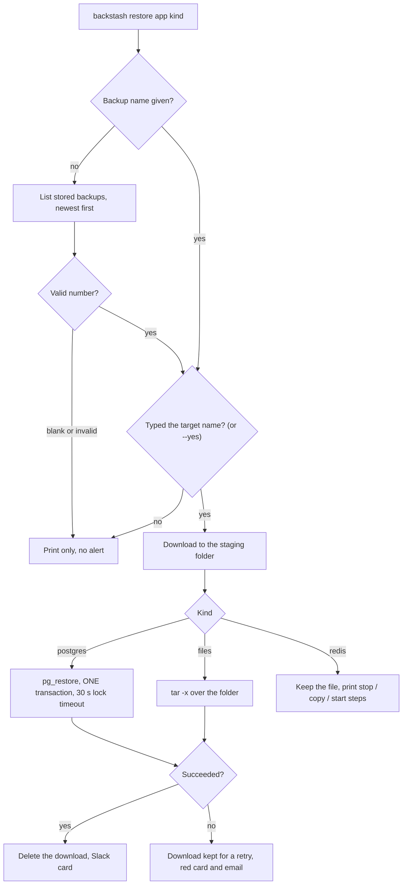
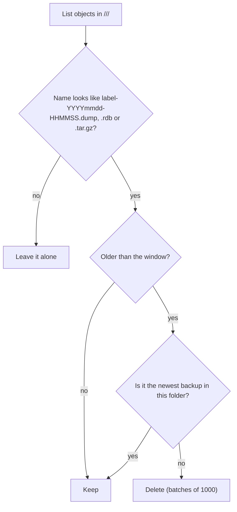
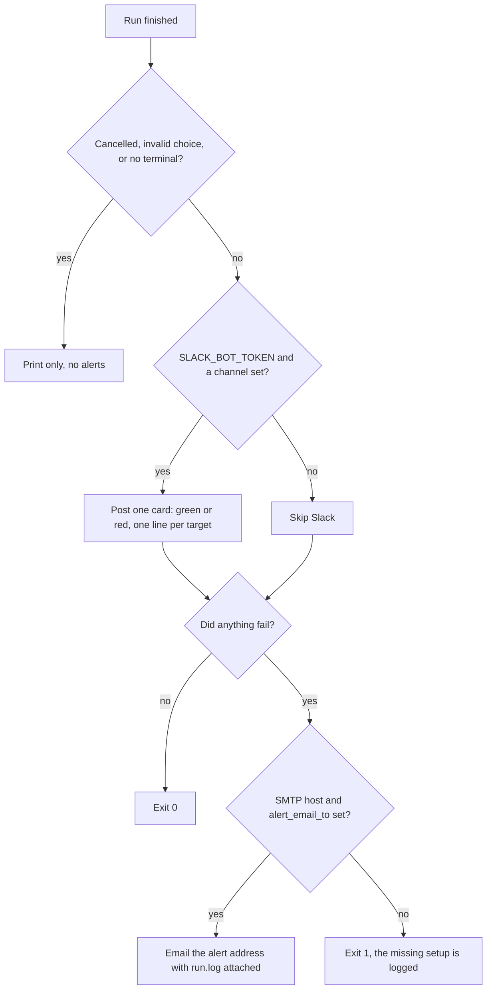

# How it works

Four flows: a backup, a restore, retention, and alerting.

## Backup

```mermaid
sequenceDiagram
    participant C as cron
    participant T as backstash
    participant I as Infisical
    participant X as Postgres / Redis / files
    participant S as bucket
    participant N as Slack and email

    C->>T: backstash backup myapp
    T->>I: read /backstash/shared and the app folder
    loop each configured target, independently
        T->>X: pg_dump / redis-cli --rdb / tar
        X-->>T: staged file (0600, in a 0700 folder)
        T->>S: upload <app>/<env>/<kind>/<name>
        T->>T: remove the local copy (unless --keep)
        T->>S: delete backups past the retention window
    end
    T->>N: one Slack card; on any failure, an email with run.log
```

| Step that fails | What happens |
|---|---|
| The dump | The partial or empty file is deleted. That target is failed; the others still run. |
| Upload | The local file is kept and its path is in the error. Pruning is skipped for that target. |
| Pruning | The backup is already stored, so the target still succeeds. A warning is shown on the card. |
| Reading secrets | Nothing runs. The command exits 1 and the error is in the cron log (see Alerts). |

A panic inside a target is caught and reported as that target's failure, so the alerts still fire.

## Restore



A failed Postgres restore leaves the database exactly as it was. Redis is never overwritten
automatically: a running Redis cannot load an RDB in place.

## Retention

Runs for each target after its upload, inside that kind's folder only. Default 30 days.



`retention_days: 0` turns pruning off. The newest backup is never deleted, so a wrong clock or a
long outage cannot leave you with nothing. Kept or failed-upload files in the staging folder age out
with the same window.

## Alerts



Alerts are best effort: a broken Slack or mail setup never turns a good backup into a failure. The
exit code reflects the backup itself (`0` all targets succeeded, `1` otherwise), which is what lets you gate a
deploy or CI step on a successful backup.

**Startup failure alerting:** if Infisical is unreachable during startup, `backstash` automatically retries with
exponential backoff. If Infisical remains unreachable, it checks for fallback notification credentials in
`identity.env` or process environment variables (`SLACK_BOT_TOKEN`, `SMTP_USER`, `SMTP_PASS`) to dispatch a critical
startup failure alert before exiting with code 1.
